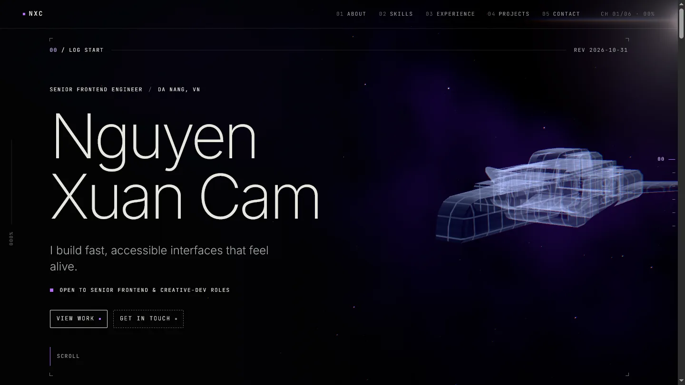
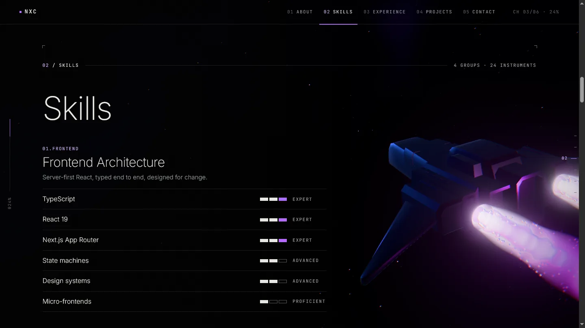
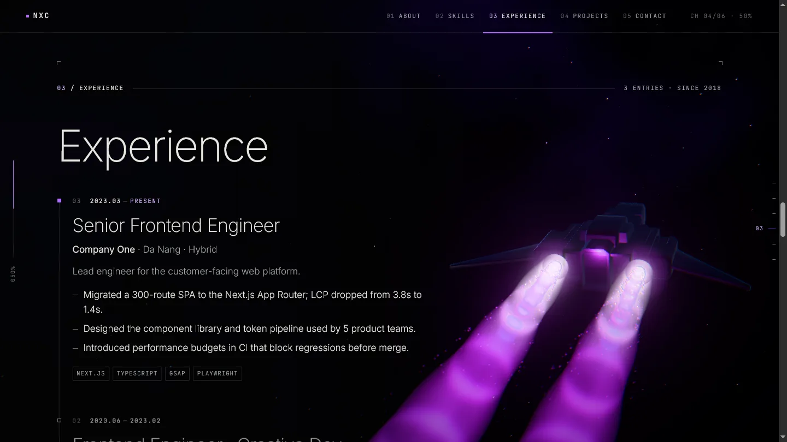
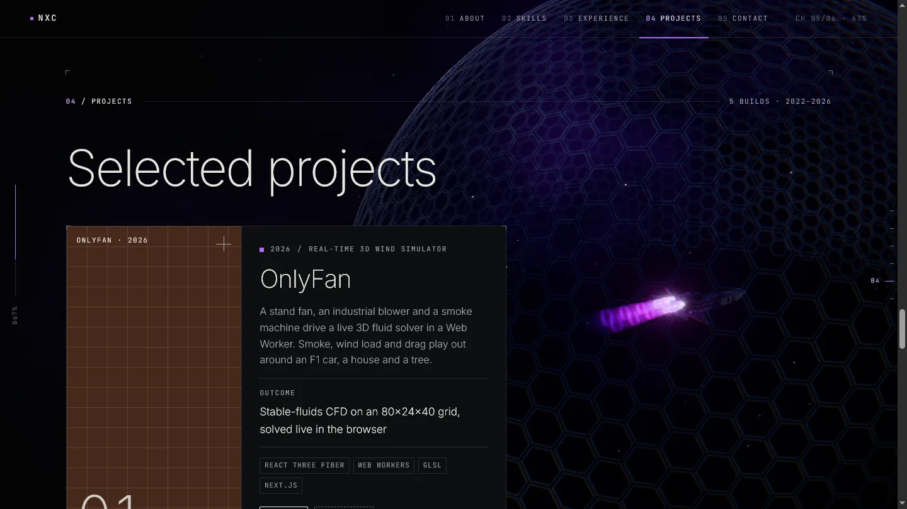
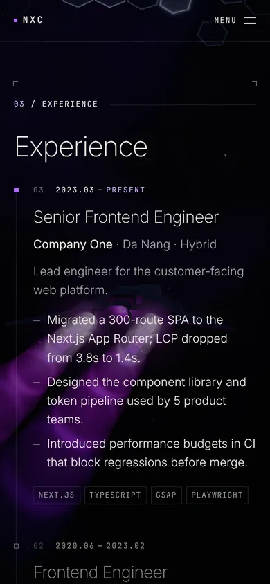

<div align="center">

# Nguyen Xuan Cam — Portfolio

**A résumé site set in deep space: a ship builds itself as you scroll, lights its plasma drive and coasts off under a hex shield.**<br/>
Next.js 16 · React 19 · Three.js / React Three Fiber · postprocessing · GLSL · CSS Modules

**[nguyenxuancam.com](https://nguyenxuancam.com)**



</div>

<table>
  <tr>
    <td width="50%"></td>
    <td width="50%"></td>
  </tr>
  <tr>
    <td><sub>Skills: the hull is complete and the twin plasma drives ignite with a kick, a flash and a camera shake.</sub></td>
    <td><sub>Experience: the camera swings behind the ship while the jets run longer and wider at full burn.</sub></td>
  </tr>
  <tr>
    <td></td>
    <td align="center"></td>
  </tr>
  <tr>
    <td><sub>Projects: the shield dome has assembled cell by cell; the ship coasts and the sky drifts slowly past.</sub></td>
    <td><sub>Phones: the ship sits centred behind a scrim, and the menu folds into a drawer.</sub></td>
  </tr>
</table>

## The scroll, chapter by chapter

| Chapter | What the stage does |
| --- | --- |
| **00 Top** | A calm hologram of the ship floating in space: stars, a violet nebula, a sun just off frame. Nothing is built yet. |
| **01 About** | The first scroll lights a welding front that sweeps along the hull, tail to nose, turning hologram into solid metal. A surface point cloud and a magenta edge light ride the front. |
| **02 Skills** | The hull completes and the engines ignite: a pink-white throat, magenta plume with shock diamonds, ion sparks, a recoil and a short camera shake. |
| **03 Experience** | Full burn: the jets grow longer and wider as the camera pulls back over the spine. A hex shield starts to assemble. |
| **04 Projects** | The burn settles to an idle glow inside the finished dome; the whole sky turns slowly past the coasting ship. |
| **05 Contact** | A wide establishing shot of the ship under its shield. |

The camera spirals around the ship from shot to shot. As it moves, the sun slides across the frame and its glare swells when the lens faces it. On wide screens a view offset keeps the ship in the free space right of the text column.

## Highlights

**Loader and motion language**
- A staged loading registry (fonts → model → shader build) drives a smoothed counter. The page reveals itself as soon as the first frames are actually on screen, with an 8 s failsafe.
- Motion is counted in 30 fps frames (`--f: 33.333ms`), with stepped `linear()` eases that ignite and cut out rather than glide. Labels scramble through glyphs on hover. Buttons are dashed and invert-fill when pressed.
- A HUD header shows the active chapter and a `CH 02/06 · 34%` readout. Rails track progress on wide screens.

**3D that stays smooth**
- The ship ("Challenger" from Quaternius's CC0 Ultimate Spaceships pack, purple variant; see [`public/models/CREDITS.md`](public/models/CREDITS.md)) is drawn three times from one geometry: solid hull, additive hologram and point cloud. All three run the same sweep function, so they agree on the front to the pixel.
- Every program is compiled with `compileAsync` before the reveal, so the first scroll never hitches. The thruster light lives outside the toggled group, so ignition never recompiles the lit materials.
- The post chain renders into a half-float target: sanitize pass → bloom → chromatic aberration (desktop only) → neutral tone mapping → vignette. All effects merge into a single fullscreen pass.
- NaN-safe by construction. `pow()` bases are clamped, normals use `safeNormalize`, every HDR output goes through `safeHdr`, and a sanitize pass stops a stray NaN before bloom can smear it across the frame.
- The galactic band is baked once into a texture on the GPU. Three star shells give real parallax as the camera travels.
- The frame loop stops while the tab is hidden. Reduced motion gets a static, fully built pose rendered on demand.

**Built for search engines and AI agents**
- The page is exported as plain static files (no server) and ships a JSON-LD `@graph` (Person, WebSite, ProfilePage, projects), a `sitemap.xml` and a `robots.txt` that welcomes AI crawlers. It also serves [`/llms.txt`](src/app/llms.txt) and [`/resume.json`](src/app/resume.json) (JSON Resume), plus a generated Open Graph image.
- All of them are generated from one typed source: [`src/content/resume.ts`](src/content/resume.ts).

**Design system**
- Void `#050607`, panel `#0c0e10`, ink `#e9e7e1`, one violet accent `#b46bff` / `#d7b4ff`. Type is Inter 200 for display and JetBrains Mono for labels.
- BEM-style class names in CSS Modules. The full brief is in [`docs/DESIGN.md`](docs/DESIGN.md).

## Structure

```
src/
  app/                 routes, metadata, llms.txt, resume.json, OG image
  content/resume.ts    the only file with personal content
  components/
    loader/            staged loader overlay
    chrome/            HUD header, rails, footer
    sections/          Hero, About, Skills, Experience, Projects, Contact
    stage/             R3F stage: director, camera rig, ship, thruster, shield, space, effects
    core/              scroll and pointer signals driver
    ui/                ButtonLink, ScrambleLabel
  lib/
    three/             materials, GLSL helpers, timeline, ship loader, thruster, space, sanitize pass
    loading/           progress registry
    scroll/            chapter signals
    motion/            frame units, flicker, scramble
    seo/               JSON-LD builder and site metadata
```

## Run it

```bash
npm install
npm run dev      # http://localhost:3000
npm run build    # static export: the whole site is written to out/
npm run preview  # build, then serve out/ through Wrangler as Cloudflare will
npm run deploy   # build, then deploy to Cloudflare Workers (run `npx wrangler login` once first)
```

The site is hosted on Cloudflare Workers as static assets ([`wrangler.jsonc`](wrangler.jsonc)); response headers live in [`public/_headers`](public/_headers). Canonical URLs default to `https://nguyenxuancam.com`; set `NEXT_PUBLIC_SITE_URL` at build time to point them elsewhere.

## License

[Apache License 2.0](LICENSE). The ship model (Quaternius, "Challenger") is CC0; see [`public/models/CREDITS.md`](public/models/CREDITS.md).

---

<div align="center">
<sub>© Nguyen Xuan Cam · <a href="https://www.linkedin.com/in/socdev/">LinkedIn</a> · nguyenxuancamit@gmail.com</sub>
</div>
