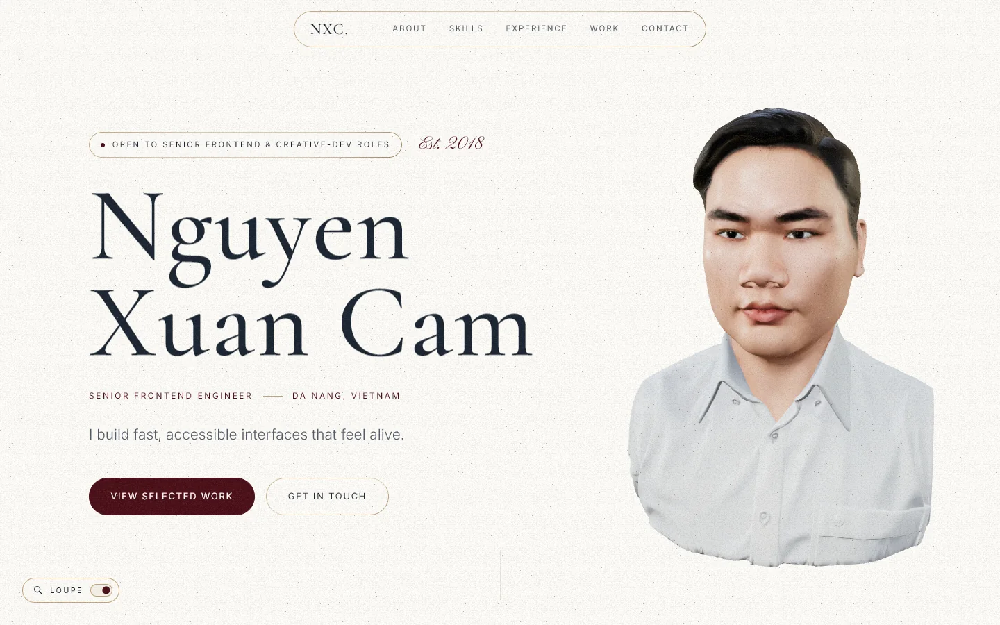
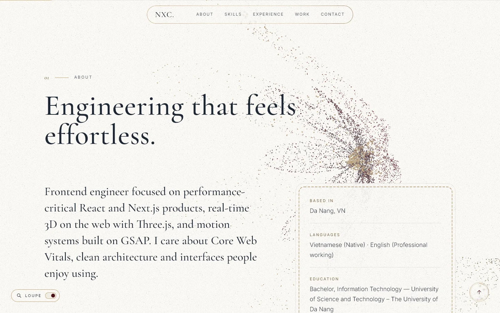
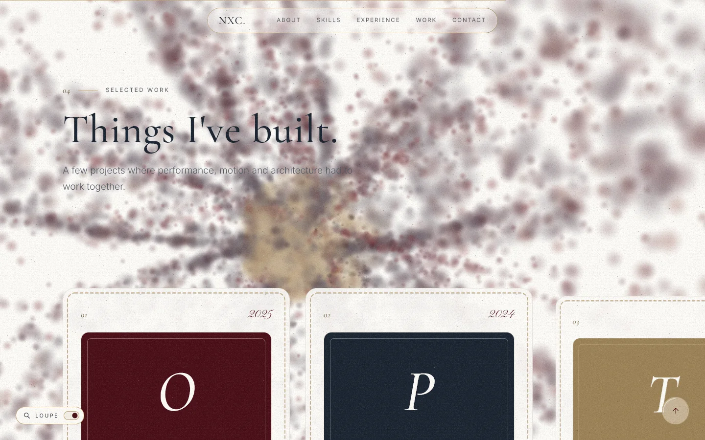
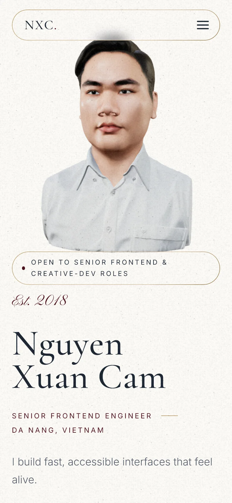

<div align="center">

# Nguyen Xuan Cam — Portfolio

**A résumé site where a 3D bust of me dissolves into a particle flower as you scroll.**<br/>
Next.js 16 · React 19 · Three.js / React Three Fiber · GLSL · anime.js · GSAP · CSS scroll-driven animations

**[nguyenxuancam.com](https://nguyenxuancam.com)**




</div>

<table>
  <tr>
    <td width="50%"></td>
    <td width="50%"></td>
  </tr>
  <tr>
    <td><sub>Scrolling bursts the bust into a flower that stays behind every section; the camera orbits to a new shot per section.</sub></td>
    <td><sub>Behind “Things I've built” the flower is thrown out of focus by a depth-of-field term in the particle shader.</sub></td>
  </tr>
</table>

## Highlights

**3D without blocking the page**
- The whole React Three Fiber scene renders in a **Web Worker on an OffscreenCanvas**, with a small DOM shim layer; scroll and pointer state are posted once per frame. Browsers without OffscreenCanvas fall back to a main-thread canvas.
- The GLB (photogrammetry bust, 15 MB → **1 MB** with meshopt + WebP via gltf-transform) is decoded with worker-based meshopt, and its surface is sampled for particles in another worker.
- Shaders are compiled with `compileAsync` before the first frame, so the intro never hitches.
- On phones a **pre-rendered poster** shows first; the 3D stage loads once the browser is idle and swaps in without a jump.

**Shaders**
- `MeshStandardMaterial` extended through `onBeforeCompile` with a noise-driven **burn dissolve** and a holographic rim.
- A particle **rose curve** (two petal layers, stamen, stem and leaves) with risograph-style stippling and a **bokeh depth-of-field** term driven by scroll position.
- Studio lighting: key, fill, rim and back lights, no environment map.

**Motion with almost no JavaScript**
- Reveals, the page progress bar, the experience rail, the back-to-top ring and the hero fade all use **CSS scroll-driven animations** (`animation-timeline: view()/scroll()`).
- GSAP + ScrollTrigger are loaded **only on desktop**, only for the pinned horizontal project rail. Lenis smooth scroll runs only for fine pointers.
- Nothing re-renders React on scroll: refs, `useFrame` mutations, `useSyncExternalStore` and IntersectionObservers.

**Liquid glass and a Sherlock loupe**
- iOS-style glass built from `backdrop-filter` with per-element, pixel-sized SVG displacement filters (edge lens, magnification, RGB split).
- The cursor is a magnifying glass made from a photographed loupe frame; it can be switched off from the bottom-left toggle.

**Old-money design system**
- Oxford navy `#1B2430`, deep burgundy `#4A0E17`, ecru `#FDFBF7`, brass `#C2A679`; Cormorant Garamond, Inter and Pinyon Script.
- Static paper grain generated once into a tile, and cards **stitched like a leather wallet** (an SVG seam with thread and hole shadow).
- BEM class names throughout, in CSS Modules.

**Built for search engines and AI agents**
- Statically prerendered App Router pages, a JSON-LD `@graph` (Person, WebSite, ProfilePage, projects), `sitemap.xml`, a `robots.txt` that welcomes AI crawlers, plus [`/llms.txt`](src/app/llms.txt/route.ts) and [`/resume.json`](src/app/resume.json/route.ts) (JSON Resume).
- Every one of them is generated from a single typed source: [`src/content/resume.ts`](src/content/resume.ts).

<div align="center">

</div>

## Structure

```
src/
  app/                 routes, metadata, llms.txt, resume.json, OG image
  content/resume.ts    the only file with personal content
  components/
    sections/          Hero, About, Skills, Experience, Projects, Contact
    three/             stage loader, worker stage + shims, portrait, camera rig, lights
    motion/            smooth scroll, cursor loupe, horizontal scroller, back-to-top
    ui/                glass lens manager, paper grain, stitching
  lib/
    three/             burst/flower shaders, camera path, bake workers
    seo/               JSON-LD builder and serializers
```

## Run it

```bash
npm install
npm run dev      # http://localhost:3000
npm run build    # every route prerenders as static
```

Set `NEXT_PUBLIC_SITE_URL` before deploying so canonical URLs, the sitemap and JSON-LD point at the real domain.

## License

[Apache License 2.0](LICENSE)

---

<div align="center">
<sub>© Nguyen Xuan Cam · <a href="https://www.linkedin.com/in/socdev/">LinkedIn</a> · nguyenxuancamit@gmail.com</sub>
</div>
